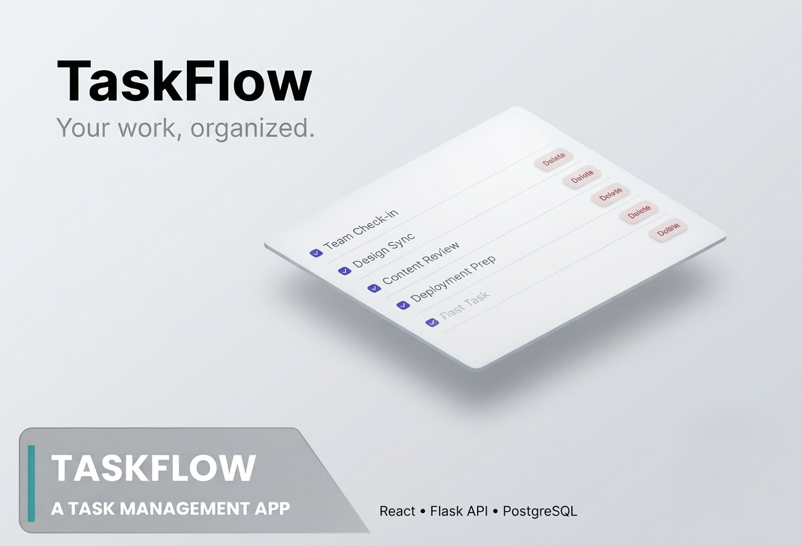
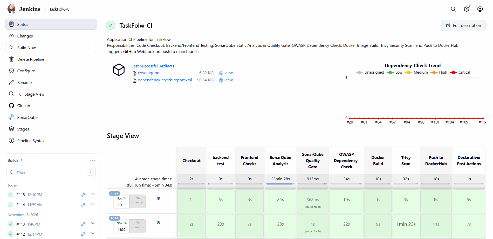
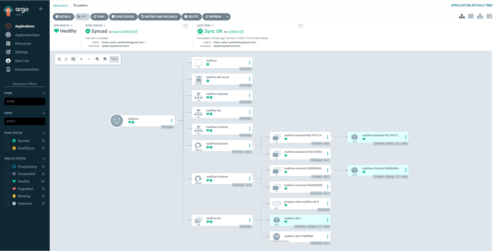
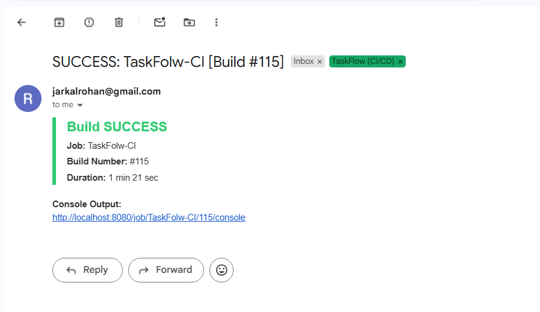
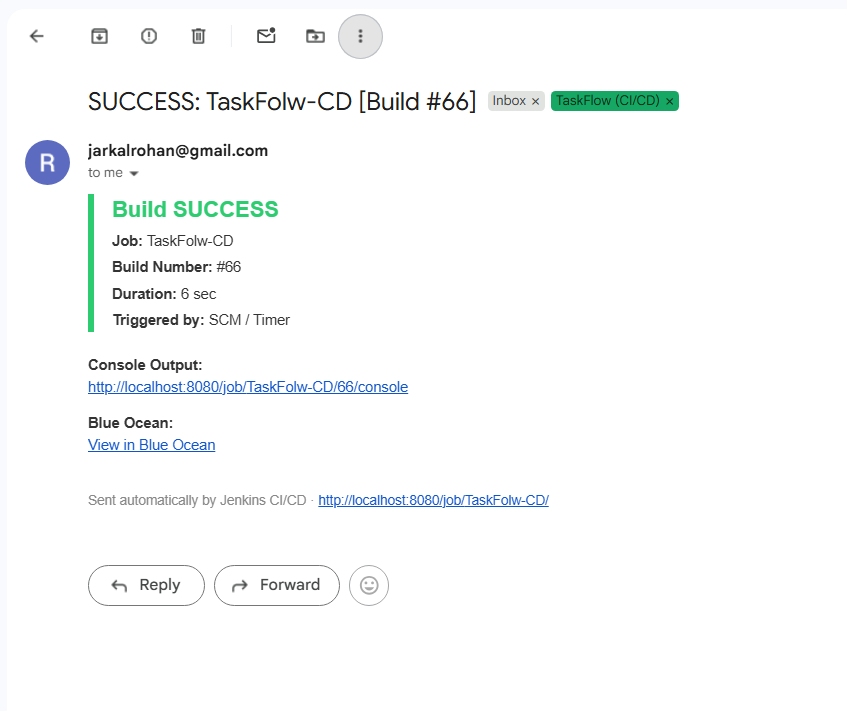

# 🚀 TaskFlow - 3-Tier Application CI/CD

TaskFlow is a modern, full-stack task management application built with a **3-tier architecture**. This repository contains the application source code, local Docker Compose setup, and the Jenkins CI Pipeline.

## 🏗️ Architecture
- **Frontend:** React (Vite) + Nginx
- **Backend:** Python (Flask) + Gunicorn
- **Database:** PostgreSQL 16
#
<!--  -->


<p align="center">
  

#

## 📸 CI/CD Pipeline Overview
1. **CI (Jenkins):** Triggers on push. Runs tests, SonarQube analysis, OWASP scan, builds Docker images, and pushes to Docker Hub.
2. **GitOps (ArgoCD):** Updates the image tags in the Kubernetes manifest repository ([`taskflow-gitops`](https://github.com/jarkalrohan-bit/taskflow-gitops)) and deploys to the cluster automatically.

### CI Pipeline


### ArgoCD Sync Status


### 📧 CI Pipeline Notifications

The CI pipeline automatically sends HTML email notifications upon completion, keeping the team updated on build status and duration.



## 💻 Local Development (Docker Compose)

### Prerequisites
- Docker & Docker Compose installed.

### Setup
1. Clone the repository:
   ```bash
   git clone https://github.com/jarkalrohan-bit/TaskFlow.git
   cd TaskFlow
   ```

## ⚙️ Setup

### 1. Clone the repository
```bash
git clone https://github.com/jarkalrohan-bit/TaskFlow.git
cd TaskFlow
```

### 2. Create your `.env` file
Create a `.env` file in the project root directory and add the following environment variables:

```env
# Database Configuration
POSTGRES_PASSWORD=taskflow_local_dev_pass

# API & Networking
VITE_API_URL=http://127.0.0.1:5000
```

### 3. Build and start the containers
Run the following command to build the images and start all containers in the background:

```bash
docker compose up --build -d
```

### 4. Access the application
Once all containers are running, access the application using the following URLs:

* **Frontend:** http://127.0.0.1:8080
* **Backend API:** http://127.0.0.1:5000/api/health

---

## 🧹 Clean Up

To stop the application and remove all local data (database volumes):

```bash
docker compose down -v
```

>⚠️ **Note:** The `-v` flag removes database volumes, which means all locally stored database data will be permanently deleted.

#

## 📦 Kubernetes Deployment

For instructions on how to deploy this application to a Kubernetes cluster via ArgoCD, please refer to the [Deployment Repository (taskflow-gitops)](https://github.com/jarkalrohan-bit/taskflow-gitops.git).

## 📧 End-to-End Notifications

Our fully automated pipeline provides real-time email updates for both CI and CD stages.

| CI Notification | CD Notification |
| :---: | :---: |
|  |  |

#